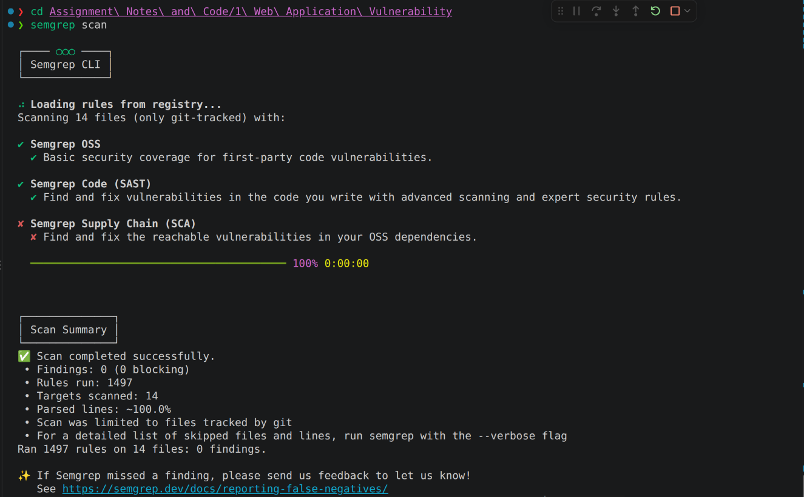
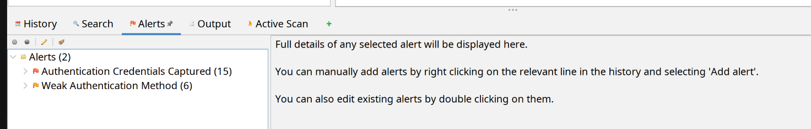
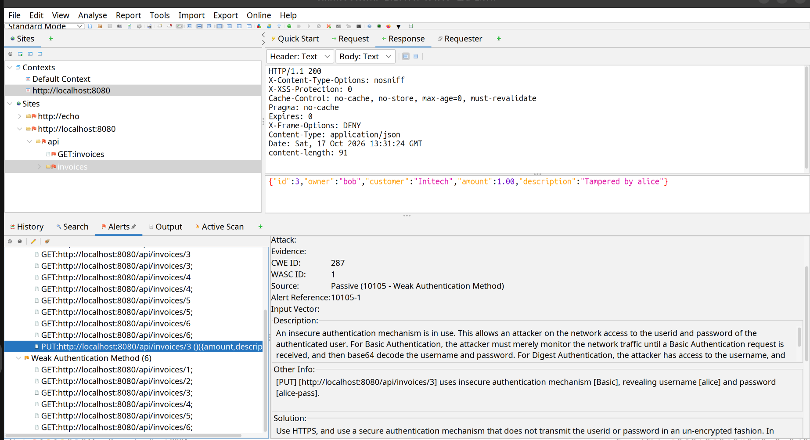
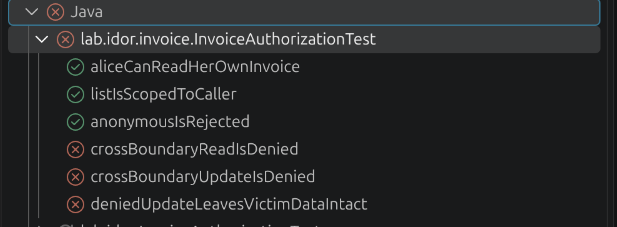
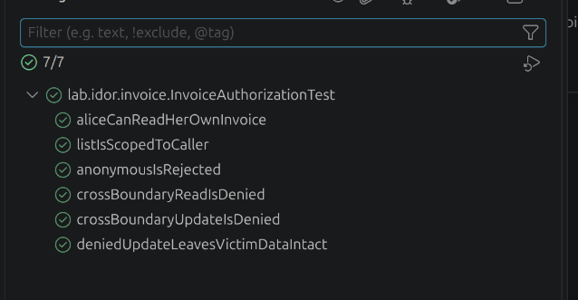

# Web Vulnerability Notes

## Insecure Direct Object Referencing (IDOR)

Linked CWEs:

- CWE-639: Authorization Bypass Through User-Controlled Key
- CWE-862: Missing Authorization

OWASP Top 10 2025 Mapping: A01: Broken Access Control [^OWASP2025AO1]

### Vulnerability Explanation: Underlying Security Theory, Relevant Weaknesses and Classification

This laboratory example demonstrates an Insecure Direct Object Reference (IDOR) in a Spring Boot invoice API, where an endpoint acts upon a client-supplied object identifier without confirming that the authenticated user is authorised for that particular object. Authentication is enforced on every route, but authorisation is applied per endpoint rather than per object. This means that any logged-in user may reach another user’s data by altering a single path value. The weakness maps to CWE-639 (Authorization Bypass Through User-Controlled Key), a child of CWE-862 (Missing Authorization), and to OWASP A01:2025 – Broken Access Control [^MITRE2026CWE639][^MITRE2026CWE862][^OWASP2025AO1]. The two accounts within the demo share a single user role, meaning that the attack constitutes horizontal privilege escalation rather than a failure of authentication.

### Demonstration of Exploitability

The vulnerable endpoints bind the invoice identifier directly from the request path and load the corresponding record through `repository.findById(id)`, returning or persisting it with no comparison between the object’s owner and the authenticated principal (IDOR Controller Listing). Authenticated as Alice, a legitimate low-privilege user, a `GET` request to `/api/invoices/3` returned Bob’s confidential invoice with an HTTP 200 response (Figure \ref{fig:idorread}). Iterating the sequential identifier enabled complete enumeration and disclosure of the dataset. The identical omission on the corresponding `PUT` request allowed Alice to overwrite Bob’s invoice, a change that persisted and remained visible from Bob’s own account (Figure \ref{fig:idorwrite}). Confidentiality of the invoice is breached and integrity weakened, since records may be read and altered across ownership boundaries, whilst availability is unaffected. The exploit required only curl and a valid low-privilege credential, with no elevated rights or specialist tooling.

```java
/**

* Controller for managing invoices. Every endpoint requires authentication (see

* SecurityConfig), so a scanner or reviewer checking for endpoint protection

* records will find them all protected. The flaw within the code is that the

* detail and update endpoints never check whether the user owns the object.

*/

@RestController

@RequestMapping("/api/invoices")

public class InvoiceController {

  

private final InvoiceRepository repository;

  

public InvoiceController(InvoiceRepository repository) {

this.repository = repository;

}

  

// SAFE: the list is scoped to the logged-in user.

// The developer factored for ownership here, but did not consider to apply it to the per-object endpoints.

@GetMapping

public List<Invoice> listMine(Principal principal) {

return repository.findByOwner(principal.getName());

}

  

// VULNERABLE (CWE-639): The ID comes straight from the URL and is used to load the record without an ownership check.

// Any authenticated user can read any invoice. Impact: confidentiality.

@GetMapping("/{id}")

public Invoice getOne(@PathVariable Long id) {

return repository.findById(id) 

.orElseThrow(() -> new ResponseStatusException(HttpStatus.NOT_FOUND));

}

  

// VULNERABLE (CWE-639): The same check is missing for a state-changing operation.

// Any authenticated user can modify any invoice. Impact: integrity.

@PutMapping("/{id}")

public Invoice update(@PathVariable Long id, @RequestBody InvoiceUpdate update) {

Invoice invoice = repository.findById(id)

.orElseThrow(() -> new ResponseStatusException(HttpStatus.NOT_FOUND));

invoice.setAmount(update.amount());

invoice.setDescription(update.description());

return repository.save(invoice);
}
```

*Listing: The vulnerable endpoints within InvoiceController.java*

### Identifying the Vulnerability Using Techniques and Tools

Static analysis with Semgrep raised no finding, as its rules match insecure API usage rather than absent authorisation logic (Figure ). An authenticated OWASP ZAP active scan also failed to report the IDOR Vulnerability, since the endpoint returns a well-formed HTTP 200 and a dynamic scanner has no model of object ownership. Confirmation of the flaw needed to occur according to methods outlined in OWASP WSTG-ATHZ-04, by replaying Alice’s request against Bob’s identifier (Figure ). A JUnit integration test (Listing ) asserting a non-2xx response to cross-user access was created, which failed against the vulnerable build (Figure ), confirming the presence of CWE-639 where the SAST and DAST tooling failed.


*Figure: Semgrep scan failing to identify IDOR vulnerability using SAST rules.*


*Figure: Complete overview of OWASP ZAP alerts, showing no IDOR flag.*


*Figure: OWASP ZAP incorrectly only detecting the weak laboratory password during malicious data modification.*


*Figure: Crafted JUnit tests successfully detecting (Failing) the IDOR vulnerability within pre-patched code.*

*Listing: JUnit test cases to catch IDOR within the application.*

```java
@Test
    @DisplayName("Alice cannot read Bob's invoice (ID 3)")
    void crossBoundaryReadIsDenied() throws Exception {
        mvc.perform(get("/api/invoices/3").with(httpBasic("alice", "alice-pass")))
                .andExpect(status().is4xxClientError());
    }

    @Test
    @DisplayName("Alice cannot update Bob's invoice (ID 3)")
    void crossBoundaryUpdateIsDenied() throws Exception {
        mvc.perform(put("/api/invoices/3")
                .with(httpBasic("alice", "alice-pass"))
                .contentType(MediaType.APPLICATION_JSON)
                .content("{\"amount\": 1.00, \"description\": \"Tampered by alice\"}"))
                .andExpect(status().is4xxClientError());
    }

    @Test
    @DisplayName("A denied update does not alter Bob's data")
    void deniedUpdateLeavesVictimDataIntact() throws Exception {
        // attempt the tampering (may be denied or, on the vulnerable build, succeed)
        mvc.perform(put("/api/invoices/3")
                .with(httpBasic("alice", "alice-pass"))
                .contentType(MediaType.APPLICATION_JSON)
                .content("{\"amount\": 1.00, \"description\": \"Tampered by alice\"}"));

        // Bob's own view must still show the original record
        mvc.perform(get("/api/invoices/3").with(httpBasic("bob", "bob-pass")))
                .andExpect(status().isOk())
                .andExpect(jsonPath("$.owner").value("bob"))
                .andExpect(jsonPath("$.amount").value(9800.00))
                .andExpect(jsonPath("$.description").value("Payroll system - CONFIDENTIAL"));
    }
```

### How to Mitigate the Vulnerability

To fix the vulnerability, ownership at the point of data access needed to be enforced. Each per-object endpoint now resolves its record through repository.findByIdAndOwner(id, principal), so an invoice is retrieved only when its owner matches the authenticated caller (Listing \ref{lst:fixedcontroller}). A non-matching identifier yields no row and returns HTTP 404, which both denies access and conceals whether the invoice exists, following the OWASP Authorization Cheat Sheet and ASVS V4 access-control requirements [@owaspauthz; @owaspasvs]. Enforcing the rule inside the query, rather than through a conditional a developer may omit, makes authorisation the default for every lookup. Replacing sequential identifiers with UUIDs was rejected as obscurity, not authorisation — useful only as defence in depth.

### Retesting For Resilience

When the fixed code was run,

Draft:
Re-running the unchanged exploit returned HTTP 404 for every cross-user request, and the JUnit suite passed in full (Figure \ref{fig:retest}), confirming the fix without altering the test. Residual risk remains: a newly added endpoint could reintroduce the pattern, so the regression test is retained in CI, and authorisation-failure monitoring is recommended (OWASP A09) [@owaspa09].


*Figure: JUnit tests passing, confirming the success of the mitigation.*

---

# Supplemental Information

## Web Application Overview

A simple command-line based invoice API with two users. Every endpoint requires login, but the per-invoice
endpoints never check that the logged-in user owns the invoice they asked for.

| Endpoint | Status |
| --- | --- |
| `GET /api/invoices` | Safe — scoped to the current user |
| `GET /api/invoices/{id}` | **Vulnerable** — read any invoice (confidentiality) |
| `PUT /api/invoices/{id}` | **Vulnerable** — modify any invoice (integrity) |

Seed data: invoices 1–2 belong to `alice`, 3–4 to `bob`.

| User | Password |
| --- | --- |
| alice | alice-pass |
| bob | bob-pass |

### Requirements

- JDK 17 or newer
- Maven 3.9+

### Running the Exploit Demo

```bash
mvn spring-boot:run
```

Then, in a second terminal:

```bash
chmod +x exploit.sh
./exploit.sh
```

Restart the app to reset the data.

## Testing Commands and Configuration

### Terminal Commands for Manual Exploit Demonstration

```bash
# 1. Alice lists her invoices

curl -u alice:alice-pass http://localhost:8080/api/invoices

# 2. Alice reads invoice 3

curl -u alice:alice-pass http://localhost:8080/api/invoices/3

# 3. Enumeration

curl -u alice:alice-pass http://localhost:8080/api/invoices/1

curl -u alice:alice-pass http://localhost:8080/api/invoices/2

curl -u alice:alice-pass http://localhost:8080/api/invoices/3

curl -u alice:alice-pass http://localhost:8080/api/invoices/4

curl -u alice:alice-pass http://localhost:8080/api/invoices/5

curl -u alice:alice-pass http://localhost:8080/api/invoices/6

# Or as a loop

for i in {1..6}; do

  curl -u alice:alice-pass http://localhost:8080/api/invoices/$i

  echo

done

# 4. Alice modifies invoice 3

curl -u alice:alice-pass \

  -X PUT \

  -H "Content-Type: application/json" \

  -d '{"amount":1.00,"description":"Tampered by alice"}' \

  http://localhost:8080/api/invoices/3

# 5. Bob lists his invoices

curl -u bob:bob-pass http://localhost:8080/api/invoices
```

#### Modified Terminal Commands for ZAP API Mapping

Run ZAP on port 8081.

```bash
# 1. Alice lists her invoices

curl -x http://127.0.0.1:8081 -u alice:alice-pass http://localhost:8080/api/invoices

# 2. Alice reads invoice 3

curl -x http://127.0.0.1:8081 -u alice:alice-pass http://localhost:8080/api/invoices/3

# 3. Enumeration

curl -x http://127.0.0.1:8081 -u alice:alice-pass http://localhost:8080/api/invoices/1

curl -x http://127.0.0.1:8081 -u alice:alice-pass http://localhost:8080/api/invoices/2

curl -x http://127.0.0.1:8081 -u alice:alice-pass http://localhost:8080/api/invoices/3

curl -x http://127.0.0.1:8081 -u alice:alice-pass http://localhost:8080/api/invoices/4

curl -x http://127.0.0.1:8081 -u alice:alice-pass http://localhost:8080/api/invoices/5

curl -x http://127.0.0.1:8081 -u alice:alice-pass http://localhost:8080/api/invoices/6

# Or as a loop

for i in {1..6}; do curl -x http://127.0.0.1:8081 -u alice:alice-pass http://localhost:8080/api/invoices/$i; echo; done

# 4. Alice modifies invoice 3

curl -x http://127.0.0.1:8081 -u alice:alice-pass -X PUT -H "Content-Type: application/json" -d '{"amount":1.00,"description":"Tampered by alice"}' http://localhost:8080/api/invoices/3

# 5. Bob lists his invoices

curl -x http://127.0.0.1:8081 -u bob:bob-pass http://localhost:8080/api/invoices
```

## Testing Configuration: Semgrep Scanning

Semgrep was run using `semgrep -scan` within the assignment repository to conduct SAST. An account was created to enable the use of semgrep's SAST rules for a comprehensive scan. Scanning failed to detect the IDOR vulnerability due to being an error within the logic of the application rather than a syntax issue.

![[semgrep_scanning_vulnerable_webapp.png]]

## Testing Configuration: OWASP ZAP

A custom header replacement rule was added to OWASP ZAP to enable the automated scanning of the active site using the in-built API policy. The full OWASP ZAP results can be viewed and verified in `OWASPZAPScanResults.csv`.


*Figure: Custom header replacement rule added to OWASP ZAP to successfully authenticate to the endpoint as Alice.*


*Figure: Attack scanning configuration, using ZAP's in-built API policy for testing.*
