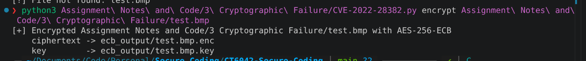
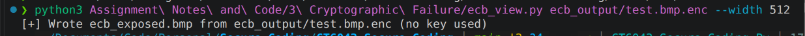
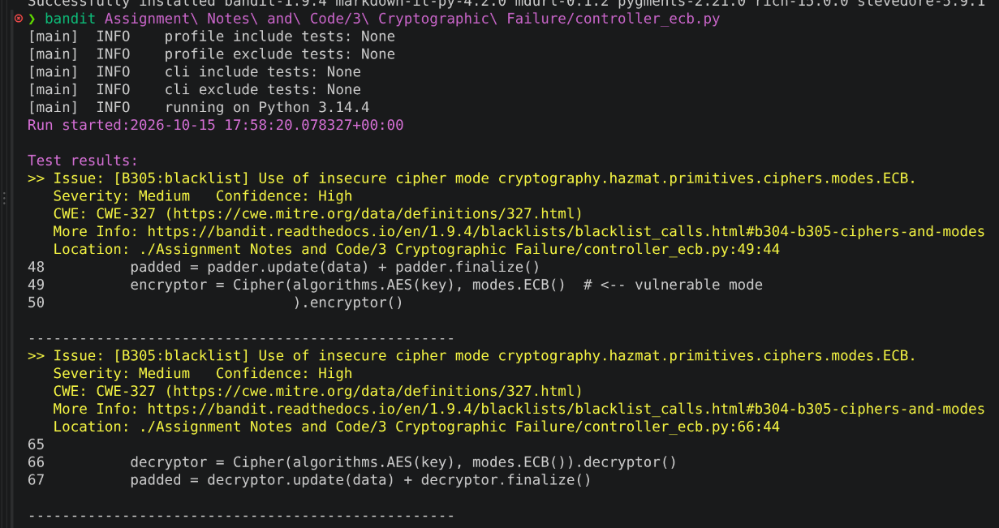
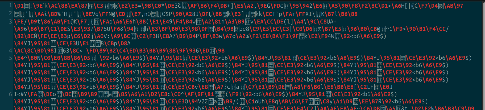
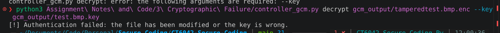
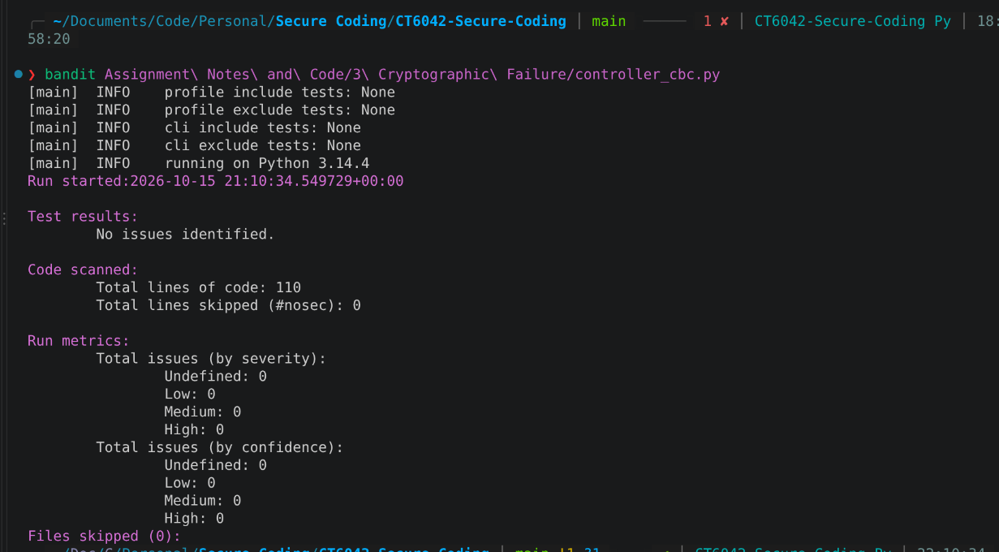
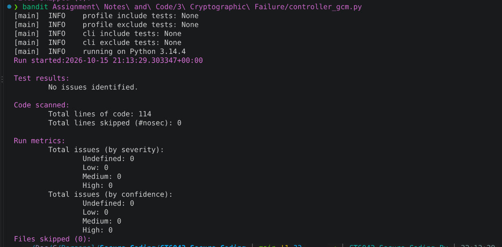
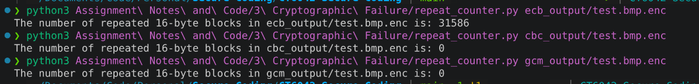

# Cryptographic Failure Notes

## CVE-2022-28382: Verbatim Drives Using AES-256-ECB Enabling Image Reconstruction

CVSS 3.1 Score: 7.5 (CVSS:3.1/AV:N/AC:L/PR:N/UI:N/S:U/C:H/I:N/A:N) [^NIST2026AESCB]

Linked CWEs: [^NIST2026AESCB][^Deeg2022AESECB]

- CWE-327: Use of a Broken or Risky Cryptographic Algorithm
- CWE-1240: Use of a Cryptographic Primitive with a Risky Implementation

OWASP Top 10 2025 Mapping: A04 Cryptographic Failures [^OWASP2025AO4]

### Vulnerability Explanation: Underlying Security Theory, Relevant Weaknesses and Classification

This laboratory example is designed to emulate a weakness found within Verbatim Keypad Secure drives discovered in 2022. The INIC-3637EN chip firmware within the drives was coded to use AES-256-ECB for encryption. When encrypting with AES, a message or file is required to be broken down into 16 byte blocks, with cipher modes such as ECB defining how blocks relate.

ECB encrypts each block independently, which has been found to be faster than other cipher modes in lab experimentation, but results in deterministic block encryption, which is detrimental to structured files such as images that have large numbers of repeating bytes [^Dworkin2001NISTECBCBC][^Riatma2025AESModes]. This enables a threat actor to breach data confidentiality through the prepending a forged header to the unchanged ciphertext.

### Demonstration of Exploitability

The initial laboratory example encrypts any file with AES-256-ECB using a random key, stores the `.enc` and `.key` files in `ecb_output/`, and decrypts them again. This is handled by the python Cryptography library, and with the program flow being shown below.

 The exploit-based verification was conducted using `ecb_view.py`, a custom python script that mirrors the techniques used in lab investigations into AES and the techniques an attacker would use by prepending a plaintext header to the encrypted file with a guessed image width [^Boussif2025AES][^Wattar2020AESImages].

*Listing: ECB mode being used within the Python encryption file.*

```python
def encrypt(data: bytes, key: bytes) -> bytes:
    """
    Encrypts data with AES-256-ECB, using PKCS7 padding.

    Args:
        data (bytes): The data to encrypt.
        key (bytes): The encryption key.

    Returns:
        bytes: The encrypted data.
    """
    padder = padding.PKCS7(BLOCK_BITS).padder()
    padded = padder.update(data) + padder.finalize()
    encryptor = Cipher(algorithms.AES(key), modes.ECB()  # <-- vulnerable mode
                       ).encryptor()
    return encryptor.update(padded) + encryptor.finalize()
```

To run the example, the following command was run in terminal:

*Listing: Bash Command to Encrypt an Image*

```bash
python3 controller_ecb.py encrypt test.bmp
```


*Figure: Command used to encrypt the image*

This produced `test.bmp.enc` by encrypting the image `test.bmp`, as well as the secret key file `test.bmp.key`.


*Figure: Sample Image Prior to Encryption.*

*Listing: Function to Append Header in ecb_view.py*

```python
def build_bmp_header(width: int, height: int) -> bytes:
    """
    Builds a standard 54-byte header for an uncompressed 24-bit BMP.

    Args:
        width (int): The image width in pixels.
        height (int): The image height in pixels.

    Returns:
        bytes: The BMP file header and info header.
    """
    row_size = (width * BYTES_PER_PIXEL +
                1) & ~3       # rows padded to 4 bytes
    pixel_bytes = row_size * height
    file_header = struct.pack(
        "<2sIHHI", b"BM", HEADER_SIZE + pixel_bytes, 0, 0, HEADER_SIZE)
    info_header = struct.pack("<IiiHHIIiiII", 40, width, height, 1, 24, 0,
                              pixel_bytes, 2835, 2835, 0, 0)
    return file_header + info_header
```


*Figure: Attack being successfully executed.*

*Listing: Command Usage to Execute Attack*

```bash
python3 ecb_view.py test.bmp.enc --width 512
```


*Figure: Image Reconstructed from Attacking Script*

### Identifying the Vulnerability Using Techniques and Tools

 To identify the vulnerability, a combination of SAST tooling and exploit-based verification was used. Bandit, the most widely adopted Python SAST tool, was able to successfully detect CWE-327 within the code, specifically attributing the use of ECB within the generated report [^Ruslan2026StaticAnalysis]. Whilst this worked for the lab example, Bandit as a tool is limited to Python, meaning that it would be unsuitable if the driver firmware is written in another language. Furthermore, Bandit's detection rule was based on the use of the `cryptography` module's `ECB` mode and failed to detect logic-based errors within the code, such as the key and encrypted objects being stored in the same directory, meaning that it could struggle to identify a manual logic-based implementation of the ECB cipher mode.

These limitations emphasise the need to use multiple tools such as exploit-based verification and byte analysis during software testing, as these can reveal patterns such as low entropy zones which create outlines in encrypted image files that SAST tooling could miss. Likewise, SAST tooling can capture a wider range of errors than a specific exploit script.

The `repeat_counter.py` script was also used to perform ciphertext block analysis on encrypted images.


*Figure: Bandit successfully detecting CWE-327 within the code*


*Figure: Repeated Bytes within the ECB Encrypted Image. There were 31,586 instances of duplicated blocks, out of 49,155 total.*

### How to Mitigate the Vulnerability

Mitigation of the vulnerability would occur during the PW.2, PW.7 and PW.8 of the NIST SSDF, when developers define appropriate encryption methods for their application use case [^NIST2022SSDF]. Developing firmware for constrained devices like the INIC-3637EN poses an additional challenge of balancing a cryptographically secure cipher mode with limited available processing power, which had to be considered when proposing mitigations.

The first mitigation is to use AES-256-CBC, which uses an Initialisation Vector to chain blocks and eliminate the repeated byte patterns at the cost of introducing a non-parallelisable mode and increasing the size of files with a 16 byte IV [^Dworkin2001NISTECBCBC][^Munir2024ImageEncryption]. Whilst CBC is vulnerable to padding attacks, the impact of this risk is reduced within the system context, as drives have no oracle to report padding[^Boussif2025AES]. The second mitigation option is to use AES-256-GCM, includes authentication methods to identify tampering [^Dworkin2007NISTGCM]. Whilst more processing power is consumed than the other two methods, AES-256-GCM has still be identified as suitable for constrained device development [^Riatma2025AESModes].

*Listing: Updated Code with CBC Encryption for Chaining*

```python
def encrypt(data: bytes, key: bytes) -> bytes:
    """
    Encrypts data with AES-256-CBC, using PKCS7 padding and a random IV.

    Args:
        data (bytes): The data to encrypt.
        key (bytes): The encryption key.

    Returns:
        bytes: The IV followed by the encrypted data.
    """
    iv = os.urandom(IV_LEN)     # new random IV for every encryption
    padder = padding.PKCS7(BLOCK_BITS).padder()
    padded = padder.update(data) + padder.finalize()
    encryptor = Cipher(algorithms.AES(key), modes.CBC(iv)  # <-- chained mode
                       ).encryptor()
    return iv + encryptor.update(padded) + encryptor.finalize()
```

*Listing: Amended Code Using AES-256-GCM for Encryption.*

```python
def encrypt(data: bytes, key: bytes) -> bytes:
    """
    Encrypts data with AES-256-GCM, using a random nonce.

    Args:
        data (bytes): The data to encrypt.
        key (bytes): The encryption key.

    Returns:
        bytes: The nonce, followed by the encrypted data and authentication tag.
    """
    nonce = os.urandom(NONCE_LEN)   # new random nonce for every encryption
    encryptor = Cipher(algorithms.AES(key), modes.GCM(nonce)  # <-- authenticated mode
                       ).encryptor()
    ciphertext = encryptor.update(data) + encryptor.finalize()
    return nonce + ciphertext + encryptor.tag
```

*Listing: AES-256-GCM decryption, with the ability to raise an error if tampering is detected.*

```python
def decrypt(data: bytes, key: bytes) -> bytes:
    """
    Decrypts data with AES-256-GCM, verifying the authentication tag.

    Args:
        data (bytes): The nonce, followed by the encrypted data and authentication tag.
        key (bytes): The decryption key.

    Returns:
        bytes: The decrypted data.

    Raises:
        InvalidTag: If the data has been modified or the key is wrong.
    """
    nonce, ciphertext, tag = data[:NONCE_LEN], data[NONCE_LEN:-
                                                    TAG_LEN], data[-TAG_LEN:]
    decryptor = Cipher(algorithms.AES(key), modes.GCM(nonce, tag)).decryptor()
    return decryptor.update(ciphertext) + decryptor.finalize()
```


*Figure: Tamper Detection Catching a Modified Encrypted File*

### Retesting For Resilience

Both proposed solutions underwent the same testing as the initial ECB code. In both cases, Bandit no longer detected the presence of CWE-327, and the produced images contained zero repeating blocks. No recognisable outlines were visible when `ecb_view.py` was run. Whilst appearing successful, these tests revealed a limitation of Bandit, as it did not detect CBC's lack of integrity protection, despite CBC being considered deprecated by OWASP [^OWASP2025AO4]. This emphasises the importance of fully analysing the limitations of potential algorithms during PW.2, as well as cross-testing to capture additional errors during PW.7 and PW.8 pf the NIST SSDF [^NIST2022SSDF].

There are also other residual risks present within the proposed fixes, such as CWE-312 due to the key being stored next to the ciphertext. Furthermore, nonce reuse is catastrophic for AES-256-GCM [^Dworkin2007NISTGCM]. Whilst the code generates a fresh nonce each time, a drive using one key for individual memory sectors could not. Thus, future work lies in evaluating the implementation of XTS-AES, which could be more storage efficient for fixed-size sectors, as it does not feature GCM's authentication tag [^Dworkin2010NISTXTSAES].


*Figure: Failed Image Reconstruction Attempt When Using CBC.*


*Figure: Bandit Detecting No Errors Within CBC Variant.*


*Figure: Failed Image Reconstruction Attempt When Using GCM.*


*Figure: Bandit Detecting No Errors Within GCM Variant.*


*Figure: Repeated Block Comparison Showing 0 Repeats in Proposed Solutions.*

## References

[^NIST2026AESCB]: <https://nvd.nist.gov/vuln/detail/cve-2022-28382>
[^Riatma2025AESModes]: <https://jurnal.polinema.ac.id/index.php/jartel/article/view/7323>
[^Boussif2025AES]: <https://ieeexplore.ieee.org/document/9826324>
[^Munir2024ImageEncryption]: <https://www.mdpi.com/2624-800X/4/1/7>
[^Dworkin2001NISTECBCBC]: <https://nvlpubs.nist.gov/nistpubs/Legacy/SP/nistspecialpublication800-38a.pdf>
[^Dworkin2007NISTGCM]: <https://nvlpubs.nist.gov/nistpubs/Legacy/SP/nistspecialpublication800-38d.pdf>
[^Wattar2020AESImages]: <https://turcomat.org/index.php/turkbilmat/article/view/14117>
[^Ruslan2026StaticAnalysis]: <https://ieeexplore.ieee.org/document/11596372/>
[^OWASP2025AO4]: <https://top10.owasp.org/2025/A04_2025-Cryptographic_Failures/>
[^Deeg2022AESECB]: <https://www.syss.de/fileadmin/dokumente/Publikationen/Advisories/SYSS-2022-002.txt>
[^NIST2022SSDF]: <https://nvlpubs.nist.gov/nistpubs/SpecialPublications/NIST.SP.800-218.pdf>
[^Dworkin2010NISTXTSAES]: <https://nvlpubs.nist.gov/nistpubs/Legacy/SP/nistspecialpublication800-38e.pdf>
