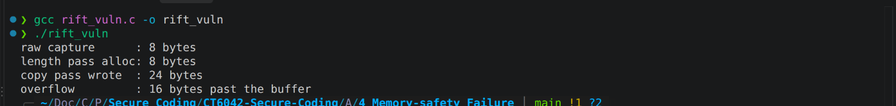
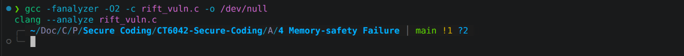
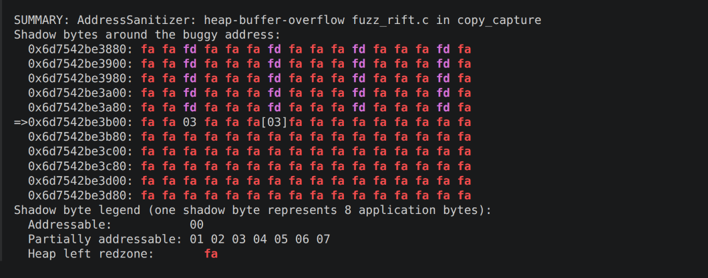
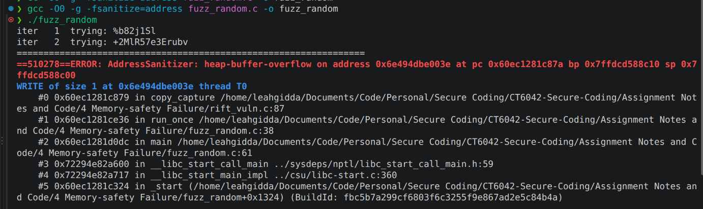
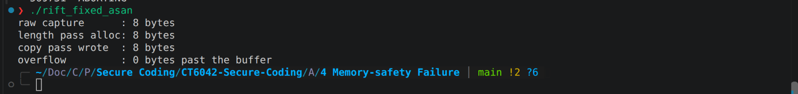
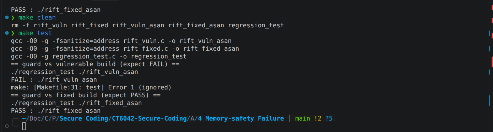

# Memory Safety Failure

## Context and Classification

This laboratory example emulates CVE-2026-42945 ("NGINX Rift"), a heap overflow in NGINX's `ngx_http_rewrite_module`[^NGINXRiftNIST]. NGINX builds rewritten strings in two passes, one sizing the heap buffer and one filling it, so correctness depends on the two agreeing[^depthfirstRift]. A question mark in the rewrite replacement sets a persistent `is_args` flag. The sizing pass on a zeroed sub-engine counts the raw capture, whereas the copy pass on the main engine escapes it and writes past the allocation. The flaw maps to CWE-131 (Incorrect Calculation of Buffer Size) manifesting as CWE-122 (Heap-based Buffer Overflow)[^CWE131][^CWE122]. NVD rates it 9.2 Critical, tempered by the non-default configuration it requires[^NGINXRiftNIST].

## Vulnerable Code and Exploit

The minimal sink is the two-pass build (Listing X). A length function and a copy function share one escape predicate, but each pass sees different engine state. The capture is N URI-escapable bytes, from plus signs padding the request path. The length pass runs on a zeroed sub-engine and sizes the buffer at raw width. The copy pass runs on the main engine, which still carries `is_args` from the rewrite's question mark, so it writes percent-encoded triples (Figure X). A buffer allocated for N bytes therefore receives 3N, overflowing by 2N (Output Figure). In NGINX the overrun crosses into an adjacent request pool. A cleanup handler sprayed there is reached on pool destruction, giving remote code execution with ASLR off, a full loss of confidentiality, integrity and availability[^depthfirstRift]. With ASLR on, the worker only crashes, a denial of service[^RedHatNginxRift].

*Figure: Diagram illustrating the two-pass script engine*


*Figure: Successful execution of the buffer overflow.*

*Listing: Vulnerable passes within rift_vuln.c*

```c
/* Escape predicate -- the single flag both passes consult. */
static int escape_active(const script_engine_t *e)
{
    return e->is_args;
}

/* Length pass: handed the zero-initialised sub-engine, so is_args == 0. */
static size_t copy_capture_len(const script_engine_t *le,
                               const unsigned char *cap, size_t raw)
{
    if (escape_active(le)) /* False here, so no escaping cost is counted. */
    {
        /* ... Add two bytes per escapable character ... */
    }

    return raw; /* Buffer is sized to the raw capture width. */
}

/* Copy pass: runs on the main engine, where is_args == 1. */
static void copy_capture(script_engine_t *e,
                         const unsigned char *cap, size_t raw)
{
    if (escape_active(e)) /* True here, so each '+' is written as %2B. */
    {
        /* ... Emit three bytes per escapable character ... */
    }
}
```

## Testing to Identify

Three techniques were applied. Static analysis came first: GCC's `-fanalyzer` and the Clang Static Analyzer both ran without detecting errors. This is expected rather than reassuring, because the undersizing and the overrun sit in different functions, gated by state set in a third, which local pattern-matching does not model (Figure P). Runtime instrumentation then exposed it. AddressSanitizer reported a heap-buffer-overflow write in `copy_capture`, one byte past an 8-byte allocation it traced to the length pass (Figure Q). A random fuzzer corroborated this, reaching the same crash within two inputs once one contained a plus sign (Figure R).


*Figure Q: -fanalyzer and Clang failing to detect the budder overflow error*


*Figure P: AddressSanitizer detecting the memory overflow in copy_capture*


*Figure R: Random fuzzer detecting the memory overflow crash.*

## Mitigating and Justification

The fix mirrors the upstream patch exactly. Nginx commit 524977e adds one line to `ngx_http_script_regex_end_code`, clearing `is_args` at the end of rewrite handling (Listing S)[^nginxFix]. The stale flag can then no longer leak into a following `set` or `if` capture, so the length and copy passes observe the same state and compute the same size. Resetting is preferable to propagating the flag into the sub-engine, because the capture in a `set` directive should be stored raw, not args-escaped. The change is a single assignment, so the performance cost is nil and no legitimate rewrite behaviour regresses.

*Listing: The fix implemented within rift_fix.c*

```c
/* Mirrors ngx_http_script_regex_end_code. */
static void script_regex_end(script_engine_t *e)
{
    e->is_args = 0; /* Upstream fix, nginx commit 524977e. */
}

/* ... in main, at the end of rewrite handling, before the set capture: */
script_regex_end(&e);
```

## Retest and Residual Risk

Re-running the trigger against the fixed build reports zero overflow, and AddressSanitizer is silent. The regression guard, which fails on the vulnerable binary, now passes, and belongs in CI so dynamic testing catches any recurrence pre-release (SSDF PW.8, RV.3). Residual risk remains as sanitizers only cover executed paths, hardening is not correctness, and unpatched instances stay exposed.


*Figure: Address Sanitizer passing the amended code.*


*Figure: regression_test.c failing the vulnerable code, and passing the patched code.*

# Testing Information

## To run the initial exploit

Within the project root, run

```bash
gcc rift_vuln.c -o rift_vuln
./rift_vuln
```

## To identify the vulnerability in the file

SAST:

```bash
gcc -fanalyzer -O2 -c rift_vuln.c -o /dev/null   
clang --analyze rift_vuln.c                       
```

Fuzzers:

```bash
clang -fsanitize=fuzzer,address fuzz_rift.c -o fuzz_rift
./fuzz_rift

gcc -O0 -g -fsanitize=address fuzz_random.c -o fuzz_random
./fuzz_random
```

Running the regression test on both versions:

```bash
gcc -O0 -g -fsanitize=address rift_vuln.c  -o rift_vuln_asan
gcc -O0 -g -fsanitize=address rift_fixed.c -o rift_fixed_asan
./regression_test ./rift_vuln_asan    # FAIL  (expected — proves the guard works)
./regression_test ./rift_fixed_asan   # PASS
```

or

```bash
make test
```

The make file can also `clean` or `create`.

# References

[^NGINXRiftNIST]: <https://nvd.nist.gov/vuln/detail/cve-2026-42945>

[^depthfirstRift]: <https://depthfirst.com/research/nginx-rift-achieving-nginx-rce-via-an-18-year-old-vulnerability>

[^nginxFix]: <https://github.com/nginx/nginx/commit/524977e7c534e87e5b55739fa74601c9f1102686>
